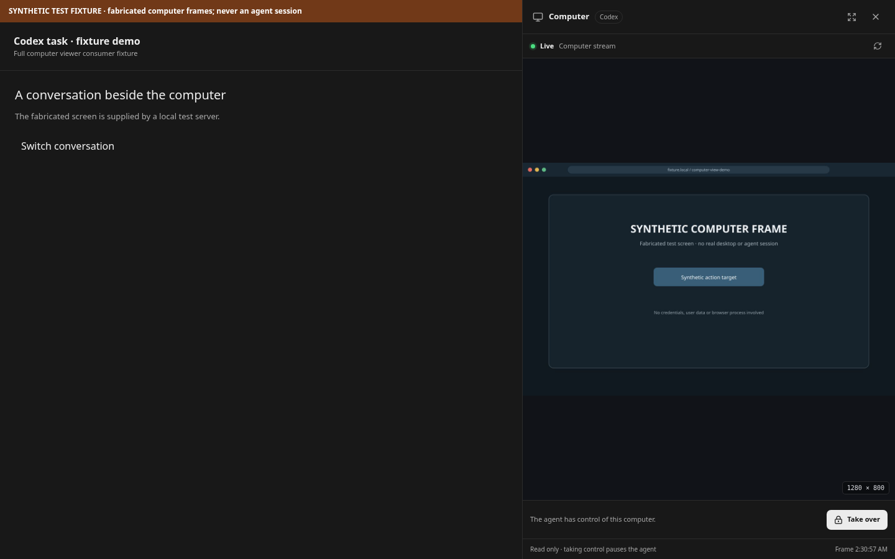
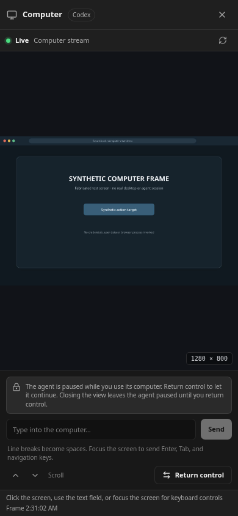

# Computer view UX references

Research checked October 14, 2026. Product names and behaviors below are separated from design recommendations. Images are linked from the companies' own pages; no reference artwork was generated.

## Confirmed product identities

- **OpenAI dots** is an official ChatGPT product: [Introducing dots](https://chatgpt.com/features/dots/) and the [OpenAI announcement](https://openai.com/index/introducing-dots/). “Dots” is the product name, not a generic computer-use feature.
- **Grok Bot** is the relevant xAI/SpaceXAI and Cursor agent product: [Introducing Grok Bot](https://x.ai/news/introducing-grok-bot) and [Grok Bot docs](https://docs.x.ai/grok-bot/overview). “Grockbot” (with a c) resolves to a separate `grockbot.fun` result and is not the official product name. Do not use that site as a UX source.
- **Muse** is Meta’s personal AI agent, with a dedicated browser computer called Muse Secure VM: [Meta launch announcement](https://about.fb.com/news/2026/09/introducing-muse-personal-ai-agent/) and [How We Designed Muse](https://introducing.muse.ai/).

## Official visual references

### OpenAI dots

The official [dots product page](https://chatgpt.com/features/dots/) has product imagery and a launch film, but the imagery surfaced in the page is primarily chat, work-result, and agent identity material. The official [Getting started with your dot guide](https://help.openai.com/en/articles/20001530-getting-started-with-your-dot) documents opening the computer from the dot profile and interacting with it; its public page does not expose a static screenshot of that live computer view. The page's image assets below are authentic product visuals, useful for the surrounding chat/profile context but not evidence of the computer canvas itself:

### Grok Bot

The official [Use the computer and apps guide](https://docs.x.ai/grok-bot/computer-and-apps) describes the computer preview but exposes no product screenshot in the public page rendering. Its official wording is specific: open the computer from a conversation; the preview shows clicks, typing, navigation, and current status. The official [launch page](https://x.ai/news/introducing-grok-bot) includes a product demo video. Treat those as behavioral references, not as a verified visual design capture.

### Meta Muse

Meta’s design article publishes actual Muse UI images, including the activity view and goal tracking. These are screenshots of Muse’s app status and history, not screenshots of the Secure VM desktop/browser.

Meta also hosts a [launch video](https://about.fb.com/wp-content/uploads/2026/09/Introducing-Muse_Sizzle-Video.mp4) and a [shopping task video](https://about.fb.com/wp-content/uploads/2026/09/Muse_Shopping.mp4). These are official motion references; this research pass did not extract video frames.

## Verified behavior relevant to “View the bot’s computer”

### Directly documented

- **Dots:** Open a dot profile, then open its computer to view and interact with it. On mobile, the computer opens “in your control.” The help article also describes a computer takeover flow: select **Take over**, finish a sign-in or verification step, then **Return control** so the dot can continue. Sign-in can require a user action, and expired app connections have a reconnection request. [OpenAI Help Center](https://help.openai.com/en/articles/20001530-getting-started-with-your-dot)
- **Grok Bot:** Open the computer from the conversation. The preview shows action traces (clicks, typing, navigation) and current status, while the work keeps running if the preview, app, or laptop closes. For passwords, passkeys, 2FA, CAPTCHAs, payments, or human-only checks, the bot asks the user to take control for that step. Sessions usually persist, but sites can expire them or ask for verification again. [Grok Bot computer guide](https://docs.x.ai/grok-bot/computer-and-apps)
- **Muse:** The agent runs on a dedicated persistent VM with its own browser; Meta says users can intervene at any point. The product-design article puts a short current-work snippet under the avatar, opens the full activity log and approved permissions from the avatar, and uses explicit accept/reject approval cards for sensitive actions. The published images show status/activity and goals, not the live computer. [Meta Muse overview](https://ai.meta.com/muse/) · [Meta design article](https://introducing.muse.ai/)

### Design implications for CollectiveUI (inference)

- Keep the current task/chat visible beside or above the live computer, and keep the relationship to the active bot and task explicit. The public references consistently launch the computer from that bot’s profile or conversation.
- Make run state visible in the viewer and distinguish **running**, **waiting for you**, **paused**, **reconnecting**, and **offline**. This is inferred from documented status previews, approval pauses, reconnect requests, and recovery states.
- Show a compact, readable action trace near the preview (for example, “Opening settings” plus a timestamp) and link to the full activity log. Grok Bot documents action/status preview; Muse documents an activity summary and full log.
- Make takeover a clearly bounded mode with visible **Take over** and **Return control** actions. Explain when the bot is waiting and what user action unblocks it. Do not imply credentials are safe to paste into chat; both OpenAI and Grok Bot provide dedicated sign-in/takeover paths.
- Treat reconnect as a first-class recovery path: show whether the browser/session is stale, offer the user a reconnection step, and let the bot resume in the same task after control returns. This is supported by OpenAI’s explicit reconnection instructions and Grok Bot’s caveat that site sessions may expire.
- Keep account/device scope legible. Dots distinguishes its cloud computer from optional local-computer access; Grok Bot’s docs say the account computer and browser sessions are shared among that user’s Bots. CollectiveUI should state whether the viewed machine belongs to this task, bot, or account.
- Show privacy/protection cues at the point of access: identify cloud versus local machine, disclose whether a real browser session is signed in, and indicate when sensitive actions need approval. This follows the products’ documented isolation, access, and approval models; exact UI treatment here is an inference.

### CollectiveUI implementation decisions

The Codex computer opens from its conversation as a desktop side panel and a full-screen mobile dialog. The header identifies the view as **Computer** and Codex, the stream is labeled **Live** only while its most recent frame is fresh, and reconnecting or stopped states replace the image with a status message. The status timestamp stays beside the frame, where it helps the user assess whether the displayed screen is current. CollectiveUI uses the main unified ChatGPT sign-in and SIWC-managed identity for stock Codex; the native desktop device-login flow described by some external references is not part of this implementation.

Taking control explicitly pauses the current Codex task and transfers computer input to the person. The viewer says the agent is paused while the person has control; only the explicit **Return control** action resumes the task. A short-lived lease, heartbeat, server-authoritative control status, and input endpoint checks gate every click, key, scroll, and text action. A normal viewer close, lease expiry, or ordinary web-session revocation leaves the task paused. Disconnecting the ChatGPT connection while takeover is paused stops the VM without resuming the task. The viewer closes independently from the task. The visual treatment follows CollectiveUI’s native chat surfaces; it does not claim to reproduce any of the referenced products’ undisclosed computer-view styling.

For the unified identity flow, the runtime sends the managed token on stdin to a guest `--sync-token` helper. The desktop proxy owns a private SIWC Unix socket and bootstraps each stock app-server supervisor through fd 3. The intended credential boundary keeps the token in supervisor/app-server memory and exposes it to the stock app-server through its process environment, outside GUI arguments, GUI environment, and persistent files. Live SBX `/proc` and filesystem containment has not been demonstrated, so these are implementation requirements rather than verified production guarantees. The operator proof `siwcSandboxVerified` remains false by default, including for SBX, and must only be approved after live GUI/stock-process containment checks.

The SIWC credential authenticates stock Codex inference; websites open in the desktop have independent sign-in sessions. A takeover can help a person handle a website login or verification, but the desktop is not an interface for signing into ChatGPT itself.

The screenshots below come from a local Playwright fixture with a prominently labeled fabricated desktop. They document the implemented layout only; they do not show a live Codex computer or a source-product screenshot.

## Source and capture limits

The web viewer returned the official static image assets linked above and the public demo/video URLs. Its screenshot operation is PDF-only, so no fresh capture of these regular web pages or extraction of video frames was available. No image was fabricated or locally altered. For a pixel-level implementation reference, the OpenAI and Grok Bot public documentation currently establishes behavior more clearly than exact viewer styling; the Muse article offers the strongest authentic static status/activity examples.

The checked-in CollectiveUI screenshots remain synthetic layout fixtures. Live SBX schema and desktop boot, authenticated SIWC inference, and actual GUI credential containment have not been proven on this host (no usable KVM or nested namespaces). The fake-CLI and browser-fixture tests do not establish those production properties; the deployment runbook requires containment proof before enabling SIWC token synchronization, then authenticated inference and token-specific containment checks before the backend is ready.
