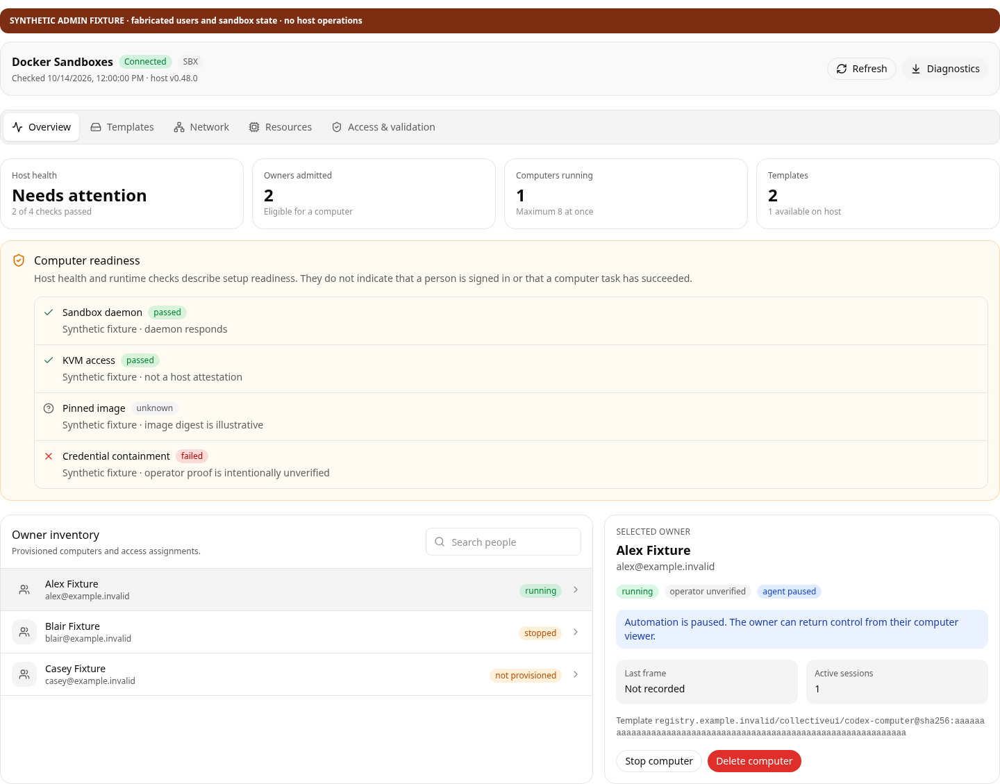
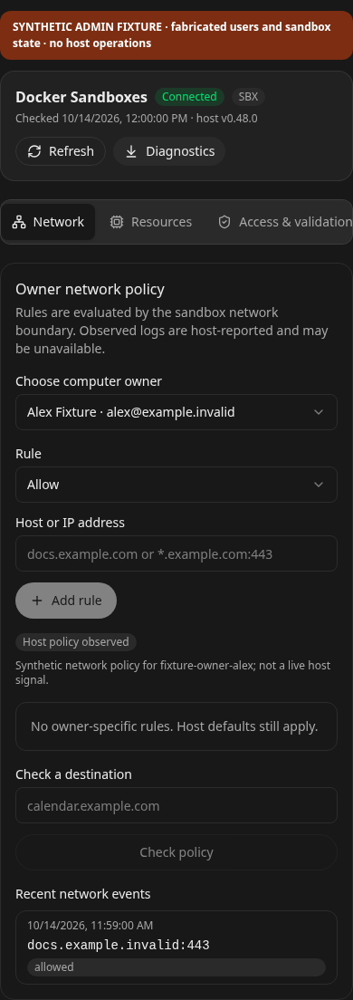

# Docker Sandboxes admin fixture captures

These screenshots are rendered from the real `DockerSandboxesAdmin` component by `tests/browser/docker-sandboxes-admin.mjs`. The browser fixture supplies fabricated `fixture-owner-*` identities, `.example.invalid` addresses, illustrative image digests, and synthetic daemon, network, validation, and runtime results. The red banner is part of each capture. No host sandbox operation, user account, credential, real network probe, or inference is involved.

- `admin-overview-light-desktop.png` — overview and owner inventory, light theme, 1440 px desktop.
- `admin-overview-dark-desktop.png` — overview and owner inventory, dark theme, 1440 px desktop.
- `admin-access-dark-desktop.png` — enrollment and operator-validation states, dark theme, desktop.
- `admin-overview-light-mobile.png` — overview and inventory, light theme, 390 px mobile.
- `admin-network-dark-mobile.png` — owner network policy and synthetic events, dark theme, 390 px mobile.





Recreate captures and run the interaction checks with:

```sh
PLAYWRIGHT_CHROMIUM_EXECUTABLE_PATH=/usr/bin/chromium node tests/browser/docker-sandboxes-admin.mjs
```
