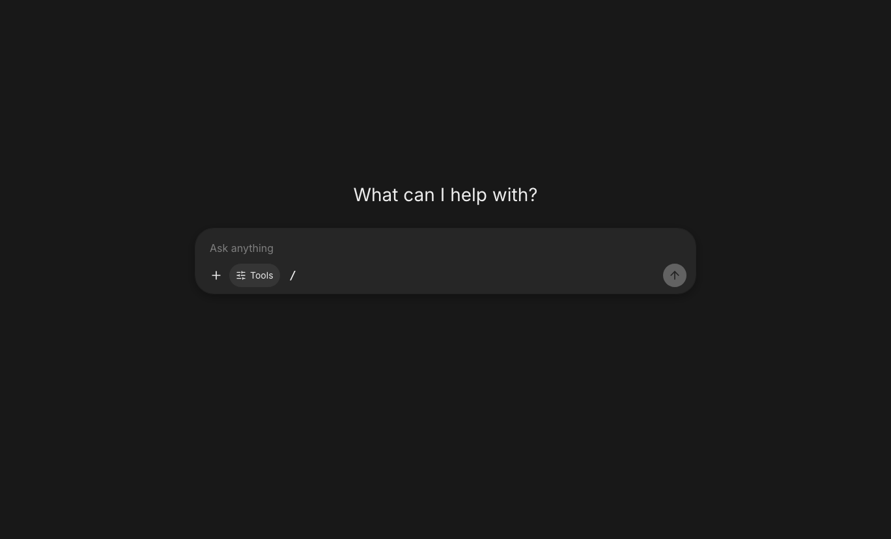

# Using CollectiveUI

[Back to the overview](../README.md) · [Local setup](getting-started.md)

## Features

The bot features below describe ordinary **native caller bots** unless stated otherwise. [Service bots](service-bots.md) have a narrower, admin-published tool set and direct-chat-only scope. [Hermes bots](connections.md#hermes-agent-bots-from-your-hermes-profiles) use their backend’s tools, skills and memory instead. The [Codex app-server preview](codex-harness.md) uses your owner-bound Sign in with ChatGPT account and a private stock runtime, with native command/file tools and persistent threads. It is disabled by default until the operator has distributed and enrolled the reviewed runtime and completed live sandbox proof. Attachments, groups, routines and delegation are unavailable; legacy manifest runtimes remain text-only. Your administrator controls which features are enabled.

**Everyday chat**

- Collapsible sidebar. History is grouped as Today, Yesterday, Previous 7/30 days and by month. Chats can be pinned, renamed, archived or deleted.
- Projects (folders) and full-text chat search (⌘/Ctrl-K).
- Model picker, a centered composer on the first screen, and streaming answers.
- Markdown with tables, highlighted code (with copy buttons) and KaTeX math.
- Edit a question or regenerate an answer; both create branches you can flip between (`‹ 2/3 ›`).
- 👍/👎 feedback on answers.
- Attach files or photos (click, drag and drop, or paste):
  - Images go to vision-capable models.
  - Text is extracted from PDF, Word and text files and added to the message.
- Share an eligible chat as a snapshot link. Only signed-in people in your organization can open it. **Continue this conversation** creates the viewer's own copy when its bot/model is still accessible and supports continuation; it never grants access to the original owner's private task records or credentials.
- Settings: theme, custom instructions, memory and learning, standing approvals, connected accounts, security and archived chats. Local accounts support passkeys and TOTP; LDAP accounts support company passkeys. Works in light and dark mode and on mobile.

*The empty model-chat screen, captured from the deployed app on 2026-10-15. [Capture notes](images/README.md).*

**Bots**

| Feature | How it works here |
|---|---|
| Named teammates with a job | A bot has a name, an avatar, a **role label**, job description, instructions, boundaries, a model and conversation starters. It can be private, shared with selected groups/people, or open to the whole organization. There is a bot editor, including "Create with chat", and a live preview. **Use as template** copies an eligible bot's definition subject to current connection access; service grants and managed runtime identities are never copied. [Pet avatars](features/bot-companions.md) add built-in, catalog and private artwork choices within each bot's identity policy. |
| Home and side chats | Selecting a bot returns to your ongoing **home chat**. **Start side chat** creates a separate focused conversation; **Chat history** keeps previous chats, routine results and archives accessible. `/new` or `/reset` starts a fresh home and keeps the old one in dated history, with its messages and memory intact. Pending work must finish or be stopped first. This changes navigation, not model context limits or memory scopes. See [agent-centered conversations](architecture/agent-conversations.md). |
| Recent activity & outputs | The bot details panel starts collapsed on each chat visit; open it with **Show bot details** in the chat header. It shows unfinished work, approvals, latest failures, and completed routine/background work. Outputs lists returned files; ordinary replies stay in the transcript. The panel also works as a dismissible sheet on mobile. |
| Memory that compounds | Eligible native bots can keep memory about each user, alongside that person's shared memory. Background extraction follows the user's memory consent and administrator controls; disabled memory, pending/denied memory requests and enforced review can prevent automatic writes. Configured bots also have `remember` and `forget` tools. Users can view, pin and delete memories. |
| Learned procedures | Eligible native caller bots can learn reusable procedures from completed direct work. The bot's **Skills** tab shows manual and learned procedures; personal preferences appear under **Memory**. Personal lessons stay private, shared lessons follow the bot's audience, and approval/opt-out controls apply. [Learning, review and maintenance](architecture/native-bot-learning.md). |
| Plugins / connectors | Built-in tools: web search (SearXNG, Brave or Bing), reading web pages (with an allowlist and protection against reaching internal addresses), knowledge files (semantic search, with keyword search as a fallback), memory, and skills. MCP servers that admins register become tools. The optional **Microsoft 365** connector can search mail, calendar and SharePoint/OneDrive, and send mail, all as the signed-in user. |
| Skills | Saved procedures: steps, decision rules, expected output and boundaries. A bot loads a skill with `use_skill` when a request matches, and users can call one directly by typing `/skill-name`. |
| Routines | Chatting with a bot shows a **side panel** with the bot card and its **Routines**. The routine editor has an Active toggle, **Test run**, and a plain-English schedule picker ("Every day at 7:30 AM", weekdays, weekly, monthly, hourly, or custom cron in any timezone). Routines can also be triggered by a signed webhook. Each run starts a new conversation and its result lands in the **Inbox**, with an optional email. Run history shows a status icon for each run. |
| Approvals | Tools follow the bot's approval settings and administrator policy. Sensitive tools ask by default; an eligible **Always allow** grant or explicit per-workspace automatic permission can remove repeated prompts. Administrators can require approval for every call. Approval cards offer **Allow once / Deny**, with **Always allow** only for eligible tools; commands never offer that remembered grant. A background routine that needs approval pauses, notifies the Inbox, and continues once someone approves it in the chat. Approvals are signed, and tool inputs always come from the server. |
| Workspace (persistent computer) | Authorized people get a private Linux workspace (a sandboxed Docker container with no network) that bots with the **Workspace** tools can use: run commands, and read, write, edit, list and search files. Files persist between chats. Settings → Workspace also lets you assign a published template version to a bot for your account, with separate private files for that bot. Unassigned bots retain the legacy shared workspace. The file browser described here remains the legacy owner-workspace view. Bot settings separate uploaded files, reads, file changes and commands into **Ask me first** or **Runs automatically** permissions. Commands and file changes ask by default; an explicit automatic setting can bypass the prompt unless organization policy requires it. Hard-denied commands stay blocked. The chat header's **Workspace** panel browses/uploads/downloads files, previews text and lets the person explicitly run commands. Output streams live with **Stop**. People can stop or reset their workspace under **Settings → Workspace**. See [workspace panels](architecture/workspace-browser.md) and [Office Bot](office-bot.md). |
| Chief of staff delegation | A bot can hand tasks to specialists through `ask_*` tools. Each assignment has a linked private task chat. Native async work returns results before the original reply continues; related follow-ups can use `continue_*` to add another turn to the same task conversation. Workspace specialists can pause for the owner's approval in either view. [Delegated tasks](features/delegated-tasks.md). |
| Default coordinator | Optional admin-selected native coordinator or editable Queen starter; specialist discovery is limited to the caller’s access and specialist opt-in, and each user keeps a private home chat. Assignments have linked task chats; native async work returns results before the coordinating reply continues. [Setup and upgrade contract](features/default-coordinator.md). |
| Group chats | Start a group with 2–6 bots (the people icon next to "Bots" in the sidebar). The first bot you pick leads and answers anything that isn't addressed. Type `@` to address one bot, or `@everyone` for all. Bots hand work to each other by @mentioning a teammate, and each bot's reply appears under its own avatar, so the handoff is visible. A single message triggers at most 6 bot replies. |
| Pin, hide & duplicate | Pin bots to the top of the sidebar or hide them; hidden bots are listed under "Hidden Bots", and hiding never pauses their routines. **Duplicate** creates "‹name› copy" with the profile, tools, skills and routines, but not conversations, memory or knowledge files. Copied routines start paused. |
| Template links | Use **Share template** to create a link that only signed-in colleagues can open. It shows a preview of the bot's identity, instructions, tools, skills and routines, with an **Add to my bots** button. You can update the snapshot or revoke the link at any time. |
| Messaging niceties | Email drafts appear as a card with **Send email / Discard**. Sending a message while a bot is still replying stops that reply and sends your new instruction. Voice dictation works in supporting browsers (Ctrl/⌘-D). ⌘/Ctrl-K finds both chats and bots. |
| Activity & audit | Every tool call, approval and denial is logged. Admins can review tool calls, routine runs and an admin audit log. |

General workspace containers remain offline. Optional [private agent browser tools and a view-only viewer](architecture/agent-browser-runtime.md) are implemented separately and default off; operator containment and egress gates must pass before activation. “Teach a task” screen recording and bots living inside Teams or Slack remain future work.

**Admin panel** (`/admin`)

- **Usage:** active users, messages, tokens, satisfaction, per-model/bot and per-user breakdowns, and CSV export.
- **Spending:** optional provider-reported API spending and allowance, configured with separate read-only billing credentials. Subscription allowance and local token estimates remain separate. See [provider spending](architecture/provider-spending.md).
- **Connections:** separate **Models** for New Chat/native bots from **Agent backends** for bots. Each model connection selects a provider model or deployment; listing a provider’s models does not create a separate connection for every model. Configure credentials, capabilities and group access here.
- **Groups:** map portal groups to Entra group object IDs and/or LDAP DNs. Groups grant connection, bot and MCP access, admin rights, and permission to create bots.
- **Users:** create local accounts and reset their passwords; see sign-in source, directory groups and last login; grant admin, disable an account or revoke sessions.
- **Bots:** every bot in the organization; enable or disable any of them.
- **Bots & tools:** who can create bots, which tools are enabled, which tools always need approval, the web-page allowlist, the web search provider, the step limit, and which models to use for background work and embeddings.
- **Connections → Agent backends:** connect a profile on your Hermes server; it becomes a bot (see [Hermes setup](connections.md#hermes-agent-bots-from-your-hermes-profiles)).
- **Managed Hermes / Hermes admission:** operator-managed private profiles and permissions for supported personal Hermes runtimes have separate setup and isolation requirements. The sidebar's **Hermes** area opens the personal remote workspace and native history; see [native Hermes](architecture/native-hermes.md).
- **MCP servers:** add or import servers (paste a Claude Desktop / Claude Code / Cursor / VS Code config), test them to review their tools, then enable them; encrypted headers, an optional signed per-user identity header, per-tool on/off and "ask first", trust, result limits, and group restrictions. Tool-list changes wait for review.
- **Workspaces:** turn them on, choose who gets one, the isolation required (gVisor, or standard Docker isolation after a confirmation), command time and output limits, and how long a disabled person's files are kept; see each person's workspace (state, isolation, last use) and stop or destroy it.
- **Activity:** tool calls, routine runs and the audit log.
- **Settings:** branding (name, uploaded logo, fallback icon, sign-in introduction, chat welcome text, default model or shared bot) and upload limits.

### Custom branding

Under **Admin → Settings → Branding**, set the portal name, upload or replace your organization logo, and customize the sign-in headline and introduction. **View sign-in page** opens an admin-only preview without signing out. Empty introduction fields use the built-in text; removing the logo restores the fallback icon. The logo appears on sign-in and in the chat sidebar; the portal name also sets the browser title.

Logos accept static PNG, JPEG, and WebP files up to **2 MB** and **2048 × 2048 pixels**. The server validates and decodes them, strips metadata, and saves a PNG up to 512 pixels on each side. SVG, HTML, animation, and remote URL imports are not supported. Logo changes save immediately; text changes use **Save branding**. Both require an active administrator account and are audited.

Branding applies to this installation. The sign-in text and active logo are public; the public logo endpoint does not expose settings or accept storage paths. Existing branding continues to work without a database migration. Logo bytes use the existing `STORAGE_DIR` (default `./data/uploads`; Docker Compose always uses its `uploads` volume at `/data/uploads`), so retain that volume with database backups and share it across web replicas. Set `AUTH_URL` to the externally visible portal origin behind a reverse proxy; logo mutations verify the browser's Origin against it. No additional service or environment variable is required.

### Where new chats start

An explicit bot/model link takes precedence. On `/`, a personal Settings choice comes first, followed by the enabled default coordinator, then the organization’s branding choice. The first available model is used only when no target is configured. An unavailable configured choice shows an explanation without switching to another provider. `/?chat=model` offers ordinary models only.

A personal or organization bot default opens a fresh ordinary chat. The coordinator default and explicit bot/sidebar selection open the person’s canonical home. These entry choices do not rewrite old chats or change `/new`. Existing model preferences continue to work, and clearing a personal choice follows the organization default.
